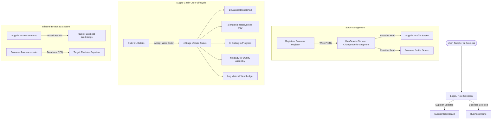

# SubSetu - Architecture, Workflows & System Diagrams

This document illustrates the technical architecture, data flows, and state management mechanisms powering the SubSetu project.

## 1. High-Level System Architecture Diagram



---

## 2. 4-Stage Reconciliation Workflow

```text
[ Supplier ]                                              [ Business Workshop ]
     |                                                             |
     |---- (Stage 1: Material Dispatched) ----------------------->|
     |                                                             |
     |<--- (Stage 2: Proof of Delivery Acknowledged via PoD) ------|
     |                                                             |
     |---- (Stage 3: Cutting / Machining In Progress) ------------>|
     |                                                             |
     |<--- (Stage 4: Quality Assembly Ready) ----------------------|
     |                                                             |
     |==== [ Material Yield Audit: 100% Reconciliation Ledger ] ===|
```

---

## 3. Material Yield Balancing Formula

The application enforces real-time ledger balancing using the following equation:

$$\text{Finished Units (kg)} = \text{Total Raw Material Issued (kg)} - \text{Usable Offcut (kg)} - \text{Scrap Shavings (kg)}$$

*Example verified in our ledger (`sample_yield_ledger.json`):*
- Total Raw Issued: **250.00 kg**
- Usable Offcut: **15.50 kg**
- Scrap / Shavings: **8.20 kg**
- Calculated Finished Units: **226.30 kg**
- Reconciliation Match: **100% Verified**

---

## 4. Screen Navigation Sitemap

```text
/ (LoginScreen)
├── /register (RegisterScreen)
│    └── /role-selection (RoleSelectionScreen)
├── /supplier-dashboard (SupplierDashboardScreen)
│    ├── /profile (ProfileScreen)
│    ├── /menu (MenuScreen)
│    │    ├── /announcements (AnnouncementsScreen)
│    │    ├── /current-order (CurrentOrderScreen)
│    │    ├── /conform-order (ConformOrderScreen)
│    │    ├── /send-order (SendOrderScreen)
│    │    └── /settings (SettingsScreen)
└── /business-home (BusinessHomeScreen)
     ├── /business-profile (BusinessProfileScreen)
     ├── /business-menu (BusinessMenuScreen)
     │    ├── /business-announcements (BusinessAnnouncementsScreen)
     │    ├── /notifications (NotificationsScreen)
     │    ├── /calculator (CalculatorScreen)
     │    ├── /help-support (HelpSupportScreen)
     │    └── /contact-us (ContactUsScreen)
     └── /order-details (OrderDetailsScreen)
          └── /update-status (UpdateStatusScreen)
               └── /log-material-yield (LogMaterialYieldScreen)
```
